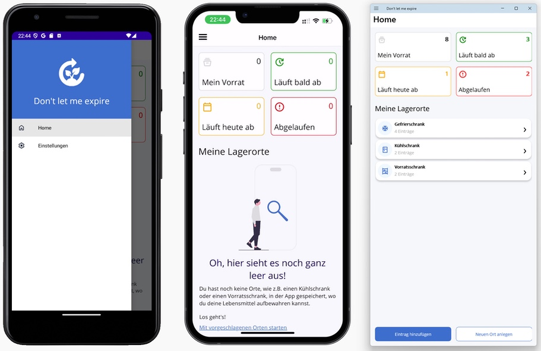

# Codebeispiele zum Buch "Cross-Plattform-Apps mit .NET MAUI entwickeln (2. Auflage)"
In diesem Repository finden Sie die Codebeispiele zu meinem Buch 
"[Cross-Plattform-Apps mit .NET MAUI entwickeln](https://www.hanser-fachbuch.de/fachbuch/artikel/9783446479814)" (ISBN: 
978-3-446-47981-4), erschienen im November 2024 beim Carl Hanser Verlag.


Dieses Buch verfolgt zwei Strategien für die Codebeispiele. In jedem Kapitel-Ordner gibt es Unterordner, die auf dem Wort Demo enden. In diesen Unterordnern finden Sie die Beispielcodes zu den Listings der entsprechenden Kapitel.

Ab Kapitel 8 gibt es außerdem in den meisten Kapitel-Ordnern den Unterordner `DontLetMeExpire`. Dabei handelt es sich um den Quellcode der Beispiel-App, die wir Schritt für Schritt in diesem Buch entwickeln werden. Der Quellcode der Beispiel-App in den jeweiligen Kapitelordnern entspricht dem Fortschritt zum Ende des Kapitels.

Inhalt der Beispiel-App ist die Umsetzung einer App zur Verwaltung von Lebensmittelvorräten



## Beispiele für .NET 8, .NET 9, .NET 10 und .NET 11

Die Beispiele für dieses Buch wurden ursprünglich für .NET 8 geschrieben. Kurz nach der Veröffentlichung des Buchs kam .NET 9 heraus. Da .NET 9 einige Verbesserungen für .NET MAUI gebracht hat, wurden alle Beispiele auf .NET 9 aktualisiert. Mittlerweile erfolgten Aktualisierungen auf .NET 10 und .NET 11. Dabei mussten einzelne Beispiele angepasst werden, weil die ursprünglich verwendeten Bibliotheken nicht mehr unterstützt werden. Die Unterschiede zum Buch finden Sie im folgenden Abschnitt. Um die Beispiele ausführen zu können, benötigen Sie Visual Studio 2026, Update 18.13 oder höher. Unter .NET 11 setzen die Android-Beispiele mindestens Android 7.0 (API-Level 24) voraus. Die ursprünglichen .NET 8 Beispiele befinden sich im Branch `net8`, die Beispiele für .NET 9 im Branch `net9` und die Beispiele für .NET 10 im Branch `net10`.

### Abweichungen vom Buch

- **Karten in Kapitel 9 (`Kap09/ViewsSample`):** Im Buch wird für die Kartendarstellung unter Windows das Paket *CommunityToolkit.Maui.Maps* mit einem Bing-Maps-Schlüssel verwendet. Seit .NET 11 bringt .NET MAUI selbst eine Windows-Implementierung des `Map`-Controls mit, die auf Azure Maps basiert. Das Beispiel verwendet daher nur noch das Paket *Microsoft.Maui.Controls.Maps*. Um die Karte unter Windows anzuzeigen, benötigen Sie einen Azure-Maps-Schlüssel, den Sie in der Datei `MauiProgram.cs` in der Konstante `YourAzureMapsKey` eintragen. Für Android benötigen Sie wie bisher einen Google-Maps-Schlüssel. Die ursprüngliche Variante mit dem Community Toolkit finden Sie in den Branches `net8`, `net9` und `net10`.
- **Barcode-Scanner in Kapitel 21 (seit .NET 10):** Die im Buch verwendete Bibliothek *Camera.MAUI* funktioniert ab .NET 10 nicht mehr. Die Beispiel-App `Kap21/DontLetMeExpire` verwendet stattdessen *ZXing.Net.Maui*, das Beispiel `Kap21/DeviceDemo` die Bibliothek *BarcodeScanning.Native.Maui*. In `DontLetMeExpire` wird die Kameraansicht (`CameraBarcodeReaderView`) nicht mehr in XAML deklariert, sondern erst beim Tippen auf den Scan-Button in der Datei `ItemPage.xaml.cs` erzeugt, nachdem die Kamera-Berechtigung angefragt wurde. Beim Ausblenden des Scanners wird sie wieder entfernt, sodass die Kamera nicht im Hintergrund weiterläuft. Damit Barcodes auch im Hochformat und zügig erkannt werden, ist die Option `AutoRotate` aktiviert und die Kameraauflösung über `CameraResolutionSelector` auf etwa 1280x720 begrenzt. Unter Windows unterstützt *ZXing.Net.Maui* das Scannen über die Kamera derzeit nicht.
- **CSS in Kapitel 18 (`Kap18/StylesSample`, seit .NET 11):** Wegen eines Fehlers im XAML Source Generator in Verbindung mit CSS ([dotnet/maui#40232](https://github.com/dotnet/maui/issues/40232)) verwendet das Beispiel den XAML-Compiler (`<MauiXamlInflator>XamlC</MauiXamlInflator>`). Damit die App auch im Debug-Modus unter iOS und Mac Catalyst startet, erzwingt die Projektdatei zusätzlich die Kompilierung mit `<_MauiForceXamlCForDebug>True</_MauiForceXamlCForDebug>`.
- **iOS und Mac Catalyst (seit .NET 11):** Mit dem iOS- bzw. Mac-Catalyst-SDK 27 verlangt Apple den UIKit-Scene-Lebenszyklus. Die Dateien `Platforms/iOS/Info.plist` und `Platforms/MacCatalyst/Info.plist` aller Beispiele enthalten daher den Eintrag `UIApplicationSceneManifest`, der auf den Scene-Delegate von .NET MAUI (`Microsoft_Maui_MauiUISceneDelegate`) verweist. Außerdem setzen die Mac-Catalyst-Beispiele mindestens Mac Catalyst 17.0 voraus. Um die Beispiele unter iOS und macOS ausführen zu können, benötigen Sie Xcode 27.2 oder höher.

## Fehler, Korrekturen und Kontakt.
Korrekturen zu fachlichen Fehlern im Buch sowie Rechtschreibkorrekturen finden Sie auf der Webseite zu diesem Buch, die Sie unter https://www.andrekraemer.de/maui-buch erreichen.

Eventuelle Fehler in den Codebeispielen werde ich kontinuierlich auf diesem GitHub-Repository korrigieren. 
Wenn Sie in den Beispielen einen Fehler finden sollten, der noch nicht korrigiert ist, dann lade ich Sie herzlich dazu ein, einen Issue über das GitHub-Repository anzulegen.

Scheuen Sie sich nicht, mich bei Fragen oder Anmerkungen zum Buch direkt per E-Mail unter andre@andrekraemer.de oder auf Twitter unter https://twitter.com/codemurai anzuschreiben.
Bitte haben Sie aber Verständnis dafür, dass ich unter der E-Mail-Adresse nur Fragen, die sich direkt auf den Inhalt des Buchs beziehen, beantworten kann.
Darüber hinausgehende Fragen kläre ich jedoch gerne in Schulungen und Workshops, die Sie auch unter dieser E-Mail-Adresse anfragen können.

## Links

- [Kostenlose Leseprobe herunterladen](https://www.bic-media.com/widget/?isbn=9783446480643&showExtraDownloadButton=yes&buyButton=no)
- [Buch bei Hanser-Fachbuch bestellen](https://www.hanser-fachbuch.de/fachbuch/artikel/9783446479814)
- [Buch bei Amazon.de bestellen](https://www.amazon.de/Cross-Plattform-Apps-NET-MAUI-entwickeln-programmieren/dp/3446479813/)
- [Webseite des Autors zum Buch](https://www.andrekraemer.de/maui-buch)
- [Schulung zum Buch](https://www.andrekraemer.de/training/app-entwicklung/cross-plattform-apps-mit-net-maui-entwickeln/)
- [Projektunterstützung anfragen](https://qualitybytes.de/services/mobile-apps/)

## Troubleshooting

### Fehler: Could not find android.jar for API level
Falls Sie beim Kompilieren der Beispiele folgenden Fehler erhalten, fehlt bei Ihnen das entsprechende Android-SDK:

```
Could not find android.jar for API level 34. This means the Android SDK platform for API level 34 is not installed. Either install it in the Android SDK Manager (Tools > Android > Android SDK Manager...), or change the Xamarin.Android project to target an API version that is installed. (C:\Program Files (x86)\Android\android-sdk\platforms\android-34\android.jar missing.)
```

Zur Fehlerbehebung müssen Sie lediglich das fehlende Android-SDK nachinstallieren. Öffnen Sie dazu in Visual Studio den *Android-SDK-Manager* im Menü *Extras | Android*